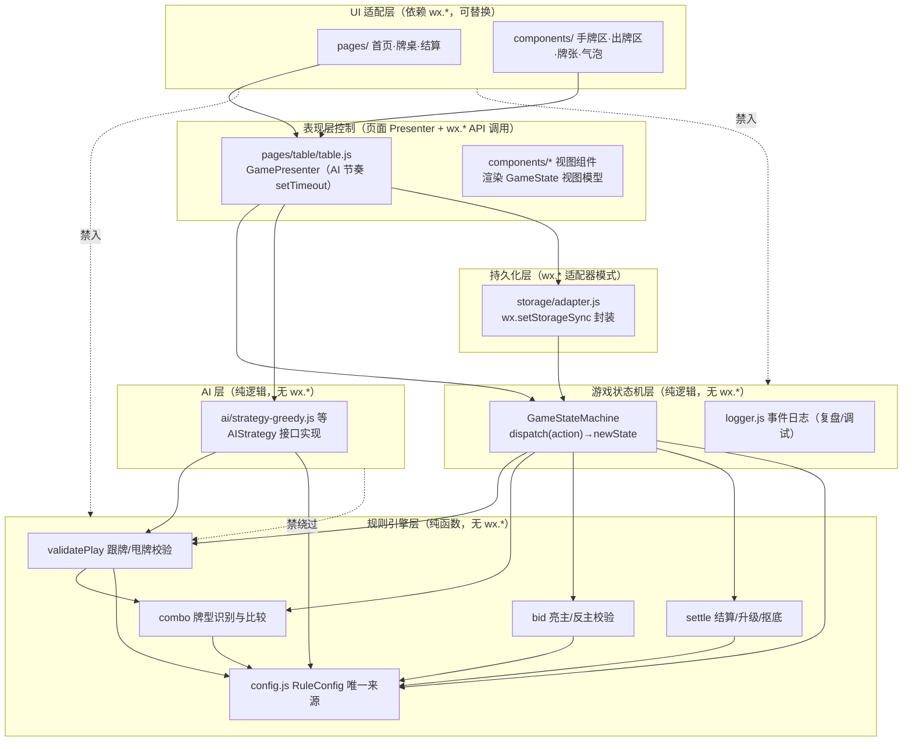
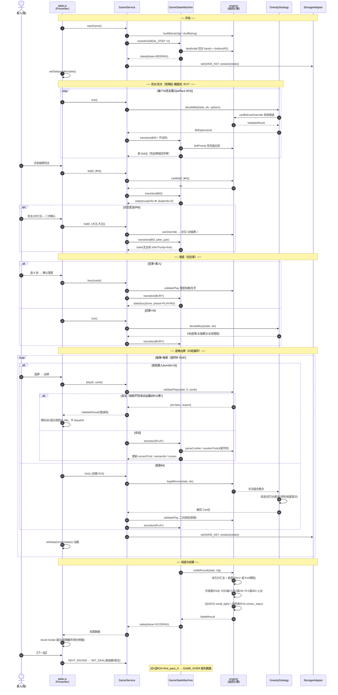
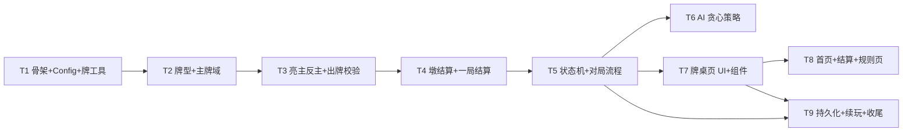

# 架构设计文档：拖拉机（升级 / 80 分）微信小程序

| 项目 | 内容 |
|---|---|
| 文档版本 | v1.0 |
| 撰写人 | 架构师 高见远（Gao） |
| 输入 | PRD v1.0（许清楚） |
| 产出目录 | F:/ftp_dictionary/weixin_app/ |
| 范围 | 单机版（P0 全量 + P1 穿插），联机版（P2 架构预留） |

---

## 0. 架构决策摘要（速览）

| 决策点 | 结论 | 一句话理由 |
|---|---|---|
| D1 框架 | **微信原生小程序 + Skyline 渲染（可选）** | 单机、单端、无跨端需求；原生无编译链负担，Taro 收益为零成本为正 |
| D2 逻辑层 | **纯 JS 模块（CommonJS）+ JSDoc 类型** | 规则引擎/AI 与视图完全解耦，Node 下直接单测 |
| D3 类型 | **JSDoc + jsconfig.json 校验（不用 TS）** | 免编译、免构建配置；小程序原生支持 CommonJS |
| D4 流程驱动 | **状态机驱动对局（纯函数 reducer 风格）** | 一切动作皆事件，天然支持断线续玩（F-09）与 P2 联机复用 |
| D5 AI 架构 | **策略接口 + 贪心启发式实现，MCTS 预留** | AI 仅通过规则引擎校验接口出牌，禁止绕过 |
| D6 样式 | **原生 WXSS（CSS 变量 + BEM 命名）** | 页面仅 3 个，无需 CSS 框架 |
| D7 测试 | **Node 内置 node:test + 原生 assert** | 纯逻辑模块零依赖直跑，CI 无需安装任何包 |
| D8 RuleConfig | **miniprogram/engine/config.js 唯一来源** | 24 参数 R1~R24 单点定义，任何模块不得硬编码规则数值 |

---

## 1. 实现方案与框架选型

### 1.1 核心技术挑战分析

| # | 挑战 | 难度 | 说明 |
|---|---|---|---|
| 1 | **拖拉机牌型判定与比较** | ★★★★ | 拖拉机"同花色相邻对子序列"需跨主/副牌域分别定义大小序；主牌拖拉机含"对王+对S-X""对副X(同花色)+对S-A"等非常规相邻；两张不同花色副级牌对不构成拖拉机（R22） |
| 2 | **甩牌成立性判定** | ★★★★ | 需对其他三家手牌按该门牌做"最大单元拆解"，逐一比较每个甩牌单元；受 R14 罚则、R11/R12 跟牌结构约束 |
| 3 | **跟牌合法性校验（严格模式）** | ★★★★ | 有对必跟对、有拖必跟拖（R11/R12 默认开）；缺门将吃须结构对应（对子→主对，拖→主拖），结构不对应视为垫牌 |
| 4 | **全参数化规则引擎** | ★★★ | 24 个 RuleConfig 参数全部可调，任何模块不得硬编码 80/40/×2/8 等数值；改一个配置整局规则即时变化 |
| 5 | **状态机对局流程** | ★★★ | 发牌→亮主/反主→埋底→逐墩→抠底→结算升级，6 个 phase + 断线续玩序列化（F-09） |
| 6 | **AI 合法出牌 100% + 策略性** | ★★★ | AI 决策必须全部经规则引擎校验；贪心启发式覆盖亮主/埋底/配合/将吃/抠底意识 |
| 7 | 四方位牌桌 UI + 手牌交互 | ★★ | 扇形手牌、选牌上浮、AI 节奏动画 |

### 1.2 框架选型：微信原生小程序（结论 D1）

**结论：微信原生小程序（原生框架 + WebView 渲染，Skyline 可选开启）。**

| 对比维度 | 原生小程序 | Taro（React 语法） |
|---|---|---|
| 单机版适配 | ✅ 完全够用 | ✅ 可用但无跨端收益 |
| 编译链/构建复杂度 | ✅ 无（保存即编译） | ❌ webpack/vite 编译链 + 依赖维护 |
| 规则引擎纯 JS 复用 | ✅ CommonJS 直接 require | ⚠️ 编译目标差异，需注意 babel 处理 |
| Node 单测直跑 | ✅ engine/ 零依赖直跑 | ⚠️ 需配 jest transform |
| 团队上手/调试 | ✅ 微信开发者工具原生调试 | 需双端调试 |
| P2 联机复用 | ✅ engine/ 纯逻辑模块服务端直接复用 | 同样需抽离 |
| 包体积 | ✅ 最小 | ❌ runtime + 转换层体积 |

**决策理由**：
1. PRD 明确"单机版优先、联机为 P2"，**无跨端需求** —— Taro 的唯一核心收益（一套代码多端运行）在本项目为零。
2. 页面仅 3 个（首页/牌桌/结算弹层），UI 规模小，组件化收益不支撑引入跨端框架的编译链成本。
3. 架构核心价值在**规则引擎纯逻辑层**（P2 服务端复用），与 UI 框架无关。原生 CommonJS 模块在 Node 下 require 即可跑单测，零构建配置（D2/D7）。
4. 后续若确需 H5 版，届时用 Taro **只重写 views/ 适配层**，engine/ 与 core/ 仍可复用 —— 解耦设计已预留此路径。

### 1.3 语言与类型：JSDoc（结论 D3）

- 全部 JS + **JSDoc 类型注解** + `jsconfig.json`（checkJs 开启），获得约 80% TS 类型安全，0 编译成本。
- 所有接口、数据结构以 TypeScript interface 语法书写在本文档 §4，实现时转写为 JSDoc `@typedef`。
- 若未来迁 TS：engine/core 两层无 UI 依赖，迁移成本极低。

### 1.4 架构模式

- **逻辑层：纯函数 reducer 风格状态机**（核心借鉴 Flux/Redux 思想，但手写轻量实现）：`dispatch(action) → newState`，禁止在 reducer 内做 IO/动画/timer。异步节奏（AI 出牌延时）由控制器层（`GamePresenter`）驱动。
- **视图层：MVP 变体**——View(WXML) 被动渲染 `GameState`；Presenter（页面 JS）持有状态机实例、转发用户事件、调 AI、写持久化。
- **AI 层：策略接口模式**——`AIStrategy` 接口 + 贪心启发式实现；接口不变，P1 换困难难度实现、P2 换 MCTS 不动框架。

### 1.5 分层架构图



**依赖铁律**（由目录约束 + 评审保证）：
1. `engine/` 内禁止 `require` 任何 `wx.*`、`pages/`、`components/`、`utils/storage` —— 保证 Node 直跑。
2. `core/` 同上（状态机也是纯逻辑，仅依赖 `engine/` 与 `ai/`）。
3. `ai/` 出牌必须先经 `engine/validatePlay` 校验候选，再选最优 —— 禁止绕过。
4. 所有规则数值只引用 `engine/config.js` —— 唯一来源。
5. `wx.*` 只允许出现在 `pages/`、`components/`、`storage/adapter.js`、`app.js`。
6. 状态机 reducer 纯函数：入参 state + action，返回新 state（结构共享，不做深拷贝），无副作用。

---

## 2. 文件列表

### 2.1 目录总览

```
F:/ftp_dictionary/weixin_app/
├── project.config.json          # 微信开发者工具项目配置（appid、编译选项）
├── project.private.config.json  # 本地私有配置（不提交）
├── jsconfig.json                # JS 项目配置：checkJs 开启，paths 别名
├── package.json                 # 仅 devDependencies（零运行时依赖）
├── README.md                    # 项目说明、启动方式、测试命令
├── docs/
│   ├── PRD-拖拉机小程序.md      # 输入：PRD
│   ├── ARCHITECTURE-拖拉机小程序.md   # 本文档
│   ├── sequence-diagram.mermaid # 对局流程时序图（独立文件）
│   └── class-diagram.mermaid    # 核心数据结构类图（独立文件）
├── tests/                       # Node 单测（node:test，命令行直跑）
│   ├── run-tests.js             # 测试入口（递归加载 engine/core/ai 用例）
│   ├── test-deck.js             # 牌堆/发牌/洗牌
│   ├── test-combo.js            # 牌型识别/排序/比较（单/对/拖/甩）
│   ├── test-trump.js            # 主牌判定/主牌序/无主局
│   ├── test-bid.js              # 亮主/反主优先级/截止
│   ├── test-validate-play.js    # 跟牌/垫牌/将吃/甩牌校验
│   ├── test-trick.js            # 墩胜负判定（逐家压过）
│   ├── test-settle.js           # 计分/抠底/升级/过A/庄传递
│   ├── test-statemachine.js     # 状态机全流程/非法 action 拒绝/序列化恢复
│   ├── test-ai-legal.js         # AI 合法性压测（≥100 局零非法）
│   ├── test-config.js           # RuleConfig 参数生效性（改参重开规则变化）
│   └── fixtures.js              # 测试牌局夹具（构造特定手牌的辅助）
└── miniprogram/                 # 小程序主体
    ├── app.js                   # 小程序入口：全局 RuleConfig 加载、onShow 恢复对局
    ├── app.json                 # 页面注册、窗口配置、Skyline 开关
    ├── app.wxss                 # 全局样式：CSS 变量（牌桌绿、牌张尺寸）、BEM 公共类
    ├── engine/                  # ★ 规则引擎层（纯函数，Node 可直跑，禁 wx.*）
    │   ├── config.js            # ★ RuleConfig 唯一来源：24 参数 R1~R24 + 校验 + 冻结导出
    │   ├── card.js              # Card 工具：编码/创建/分牌值/主牌判定/排序键 sortKey
    │   ├── deck.js              # 牌堆：按 deckCount 构建/洗牌/发牌切分
    │   ├── combo.js             # 牌型识别（单/对/拖/甩）+ 大小比较 + 主牌拖拉机判定
    │   ├── trump.js             # 主牌域构建：有主/无主局的主牌集合、主牌大小序
    │   ├── bid.js               # 亮主/反主：canBid/canOverride/优先级/截止判定
    │   ├── follow.js            # 跟牌校验：结构匹配（对/拖强制）、将吃结构对应
    │   ├── throw.js             # 甩牌校验：单元拆解 + 其他三家手牌最大单元比较（R14）
    │   ├── trick.js             # 墩结算：争胜资格判定/逐家比较/赢墩/分牌收集
    │   ├── settle.js            # 一局结算：攻方分汇总/抠底加倍(R9/R10)/升级表(R18)/过A(R15)
    │   ├── validate.js          # 出牌校验总入口 validatePlay（领出/跟牌/甩牌分派）
    │   └── errors.js            # 错误码 + RuleError（E1xx 引擎/E2xx 状态机/E3xx 持久化）
    ├── core/                    # ★ 游戏状态机层（纯逻辑，禁 wx.*）
    │   ├── state.js             # GameState 定义/创建初始状态/clone/序列化与反序列化
    │   ├── actions.js           # Action 类型常量 + 工厂函数（DEAL/BID/OVERRIDE/BURY/PLAY...）
    │   ├── statemachine.js      # ★ 状态机主体：transition(state, action)→state，phase 路由
    │   ├── dealer-ai-loop.js    # 对局循环驱动器：发牌/亮主窗口/翻底定主/无人亮主处理(R20)
    │   └── logger.js            # 事件日志：append/查询/导出（复盘 F-18 与调试用）
    ├── ai/                      # ★ AI 层（纯逻辑，禁 wx.*）
    │   ├── strategy.js          # AIStrategy 接口定义（JSDoc）+ createAI(difficulty)
    │   ├── strategy-greedy.js   # 贪心启发式（P0）：亮主/埋底/出牌策略实现
    │   └── memory.js            # 记牌器：已出牌/剩余牌/分牌统计跟踪（P1 难度分级用）
    ├── services/                # 应用服务层（纯逻辑，禁 wx.*，可延时）
    │   ├── game-service.js      # GameService：组装状态机+AI+日志 的对局门面（纯逻辑）
    │   ├── hint.js              # 出牌提示生成（P1）：合法集合中选较优组合
    │   └── stats.js             # 战绩统计（P1）：局数/胜率/最快过A 的纯计算
    ├── storage/                 # 持久化层（wx.* 只出现在 adapter）
    │   ├── adapter.js           # StorageAdapter：get/set/remove 封装 wx.setStorageSync
    │   └── keys.js              # 存储键常量 + 序列化版本号（断线续玩恢复兼容）
    ├── utils/                   # 通用工具
    │   ├── format.js            # 展示格式化：方位名/花色符号/级牌名/得分文案
    │   └── random.js            # 随机源：可注入种子（测试可复现、线上 Math.random）
    ├── pages/                   # 页面（View + Presenter 合一，wx.* 允许）
    │   ├── home/                # 首页
    │   │   └── home.js/.wxml/.wxss/.json
    │   ├── table/               # ★ 牌桌页（核心）
    │   │   └── table.js/.wxml/.wxss/.json   # table.js 为 Presenter：持有 GameService，转发事件，驱动 AI 节奏
    │   └── rules/               # 规则速查页（RuleConfig 动态渲染）
    │       └── rules.js/.wxml/.wxss/.json
    └── components/              # 自定义组件
        ├── card/                # 单张牌（花色/字面/级牌高亮/选中态/置灰）
        ├── hand-area/           # 手牌区（扇形排列、分组排序、选牌交互、埋底多选）
        ├── trick-area/          # 中央出牌区（四方位出牌摆放、横向展开）
        ├── seat-info/           # 座位信息（头像/剩余牌数/级数徽标/身份）
        ├── status-bar/          # 状态栏（主花色/级牌/双方分）
        ├── bid-bar/             # 亮主/反主气泡按钮 + 二次确认
        ├── bury-bar/            # 埋底操作条（已选计数/确认埋底）
        ├── result-modal/        # 结算弹层（得分明细/底牌翻开/升级动画）
        └── history-modal/       # 出牌历史回看（P1，最近 N 墩）
```

### 2.2 关键文件职责说明

| 文件 | 职责 | 关键导出 |
|---|---|---|
| `engine/config.js` | **RuleConfig 唯一来源**。定义 R1~R24 全部 24 参数默认值、可选范围、参数校验 `validateConfig()`、`Object.freeze` 深冻结导出 DEFAULT_CONFIG；`createConfig(overrides)` 合并用户配置 | `DEFAULT_CONFIG`, `createConfig(overrides)`, `validateConfig(cfg)` |
| `engine/card.js` | 牌的表示与基础运算：`createCard(suit, rank)`、`pointValue(card)`（5/10/K 分值）、`isTrump(card, trumpInfo)`、`sortKey(card, trumpInfo)`（主副牌统一排序键）、`sameCard(a,b)` | `createCard`, `sortKey`, `pointValue`, `isTrump` |
| `engine/combo.js` | 牌型核心：`parseCombo(cards, trumpInfo)` 识别单/对/拖/甩；`compareCombo(a, b, ctx)` 比大小；拖拉机相邻判定（主牌域含王-级牌-副X 特殊序，R22 处理） | `parseCombo`, `compareCombo`, `isTractorPair` |
| `engine/trump.js` | 主牌域：`buildTrumpInfo(trumpSuit, levelRank, isNoTrump)` 生成主牌集合与大小序；无主局仅王+8级牌 | `buildTrumpInfo` |
| `engine/bid.js` | 亮主/反主规则：`canBid(state, playerIdx, card)`、`canOverride(state, playerIdx, cards)`、优先级判定（对王>对级牌、R8/R21） | `canBid`, `canOverride`, `bidPriority` |
| `engine/validate.js` | **校验总入口**：`validatePlay(state, playerIdx, cards)` → `{ok, reason}`；内部分派领出（含甩牌 throw.js）/跟牌（follow.js） | `validatePlay` |
| `engine/trick.js` | 墩结算：`resolveTrick(plays, leadCombo, trumpInfo)` → `TrickResult`（赢墩者、争胜说明、分牌） | `resolveTrick` |
| `engine/settle.js` | 一局结算：`settleRound(state)` → 升级数/过A/下局庄家（R15/R16/R18/R24） | `settleRound` |
| `core/statemachine.js` | **状态机主体**：`transition(state, action)` 纯函数；`INIT_DEAL→BIDDING→BURYING→PLAYING→SCORING` phase 路由；内嵌合法性校验调用；非法 action 抛 RuleError 并返回原 state | `transition`, `PHASES` |
| `core/state.js` | GameState 创建/序列化：`createInitialState(config, players)`、`serializeState(state)`、`deserializeState(json)`（版本兼容检查） | `createInitialState`, `serializeState`, `deserializeState` |
| `ai/strategy-greedy.js` | P0 AI：`decideBid/decideBury/decidePlay(state, playerIdx, legalMoves)`；全部经 legalMoves（由 validatePlay 生成）内择优 | `GreedyStrategy` |
| `services/game-service.js` | 对局门面：`new GameService(config, difficulty)`；`startRound()/play(playerIdx, cards)/bid()/bury()/tick()`（tick 推进 AI 行动）；持有 logger | `GameService` |
| `pages/table/table.js` | 牌桌 Presenter：setData 渲染 GameState 派生的视图模型；onShow 恢复；AI 节奏 setTimeout（R23） | Page |
| `storage/adapter.js` | wx 同步存储封装 + 版本迁移；唯一允许 wx.setStorageSync 的模块 | `storage.get/set/remove` |

---

## 3. RuleConfig 唯一来源约定

`engine/config.js` 是全项目规则数值的**唯一来源**（目录树中 ★ 标注）：

```js
/** engine/config.js —— RuleConfig 唯一来源 */
const DEFAULT_CONFIG = Object.freeze({
  // —— 牌与发牌 ——
  deckCount: 2,                    // R1 副数
  bottomCards: 8,                  // R2 底牌张数
  // —— 级数 ——
  rankStart: 2,                    // R3 起始级牌
  rankEnd: 'A',                    // R4 终局级牌
  // —— 计分与升级 ——
  pointsToTake: 80,                // R5 上台分
  pointsPerLevel: 40,              // R6 每级分数
  cleanSweepBonusLevels: 1,        // R7 大光额外升级数
  levelUpTable: 'standard',        // R18 升级幅度表
  passACondition: 'small_light',   // R15 过A条件
  roundGoal: 'first_pass_A',       // R24 整轮目标
  // —— 主牌 ——
  allowNoTrump: true,              // R8 允许无主局
  offSuitRankTieFirstWin: true,    // R13 副级牌先出为大
  // —— 抠底 ——
  bottomMultiplier: 2,             // R9 抠底分数倍数
  bottomMultiplierByType: false,   // R10 按牌型加倍
  // —— 跟牌 ——
  mustFollowPairAsPair: true,      // R11 有对必跟对
  mustFollowTractorAsTractor: true,// R12 有拖必跟拖
  // —— 甩牌 ——
  throwPenalty: 'reject',          // R14 甩牌不成立罚则（reject/smallest）
  // —— 流程 ——
  dealerPassRule: 'winner_stays',  // R16 庄家传递
  bidDeadLine: 'before_bottom_flip', // R17 亮主截止
  playDirection: 'counterclockwise',// R19 出牌方向
  noBidFallback: 'flip_bottom',    // R20 无人亮主处理
  // —— 反主 ——
  allowSingleJokerOverride: false, // R21 单王反无主
  // —— 牌型 ——
  offSuitRankPairAsTractor: false, // R22 不同花色副级牌对构成拖拉机
  // —— 体验 ——
  aiPaceSeconds: [0.8, 1.5],       // R23 AI 节奏区间
});
```

**使用约定**：
- 所有模块 `const cfg = require('./config').DEFAULT_CONFIG`（或经 `createConfig(overrides)` 合并后的实例）传入，**函数签名显式收 cfg 或依赖注入**，禁止字面量出现 80/40/×2/8/108 等规则数值。
- `validateConfig(cfg)` 在 GameService 构造时校验（如 R5 必须能被 R6 整除的约束检查：`pointsToTake % pointsPerLevel === 0` 不强制但给出 warning）。
- 规则速查页（F-07）文案直接遍历 config 字段渲染，改配置 → 文案自动同步（验收标准 2）。

---

## 4. 核心数据结构（TypeScript 表达，实现用 JSDoc）

### 4.1 基础枚举与牌

```ts
/** 花色编码（共享约定 §8） */
type Suit = 'S' | 'H' | 'C' | 'D';   // 黑桃/红桃/梅花/方块
/** 牌面值：'3'~'10'、'J''Q''K''A'，Joker 专用 'BJ'(大王) 'RJ'(小王) */
type Rank = '3'|'4'|'5'|'6'|'7'|'8'|'9'|'10'|'J'|'Q'|'K'|'A'|'2'|'BJ'|'RJ';
/** 方位（逆时针出牌顺序 S→E→N→W） */
type Seat = 'S' | 'E' | 'N' | 'W';   // 南(真人)/东/北(队友AI)/西
/** 阵营 */
type Team = 0 | 1;                    // 0=我方(S+N) 1=敌方(E+W)
/** 阶段 */
type Phase = 'INIT_DEAL' | 'BIDDING' | 'BURYING' | 'PLAYING' | 'SCORING' | 'GAME_OVER';
```

```ts
/** 单张牌：全局唯一 id + 花色/牌面 + 是否王 */
interface Card {
  id: string;            // 唯一 id：`${deck}${suit}${rank}` 如 '0H10'、'0BJ'，用于动画与选牌
  suit: Suit | 'JOKER';  // 王为 'JOKER'
  rank: Rank;            // 'BJ'=大王 'RJ'=小王
  isJoker: boolean;      // 大小王
}
```

### 4.2 主牌信息与牌型

```ts
/** 一局的主牌域（亮主/翻底定主后生成） */
interface TrumpInfo {
  levelRank: Rank;       // 本局打几（庄家队级数）
  trumpSuit: Suit | null;// 主花色；无主局为 null
  isNoTrump: boolean;    // 无主局（对王反主 且 R8 开）
  trumpIds: Set<string>; // 主牌 id 集合（含全部王+级牌+主花色），快速 isTrump 判定
  order: Card[];         // 主牌大小序（降序，供拖拉机相邻判定）
}

/** 牌型单元 */
type ComboType = 'single' | 'pair' | 'tractor' | 'throw';
/** 甩牌单元：单张或对子或拖拉机 */
interface ComboUnit {
  type: 'single' | 'pair' | 'tractor';
  cards: Card[];         // 该单元的牌
  size: number;          // 张数（1/2/2k）
  isTrumpUnit: boolean;  // 是否主牌单元
}
/** 一次出牌的组合（领出牌型，或跟牌组合） */
interface Combo {
  type: ComboType;
  units: ComboUnit[];    // 甩牌为多单元；单一牌型为单元素
  cards: Card[];         // 全部牌（units 展平）
  n: number;             // 总张数
  suit: Suit | 'TRUMP' | 'JOKER'; // 领出花色域
  isTrump: boolean;      // 领出是否主牌域
}
```

### 4.3 对局状态（GameState，可序列化 → 断线续玩 F-09）

```ts
/** 玩家 */
interface Player {
  seat: Seat;
  team: Team;
  isHuman: boolean;
  name: string;
  hand: Card[];            // 手牌（排序键排序）
}
/** 亮主记录 */
interface BidRecord {
  playerIdx: number;
  type: 'single_rank' | 'pair_rank' | 'joker_pair' | 'single_joker'; // 亮/反主类型
  cards: Card[];           // 亮出的牌（收回手牌，仅记录展示）
  trumpSuit: Suit | null;  // 声明的主花色
  isNoTrump: boolean;
  ts: number;
}
/** 一墩中一次出牌 */
interface PlayRecord {
  playerIdx: number;
  cards: Card[];
  combo: Combo | null;    // 解析后的牌型（垫牌可能 null）
  isDiscard: boolean;     // 垫牌（不争胜）
  isEffectiveTrump: boolean; // 有效将吃（结构对应）
}
/** 一墩 */
interface TrickData {
  leadPlayerIdx: number;
  leadCombo: Combo;        // 领出牌型
  plays: PlayRecord[];     // 依次跟牌（含领出）
  winnerIdx: number | null;
  points: number;          // 本墩分牌总分
}
/** 结算结果 */
interface SettleResult {
  attackPoints: number;        // 攻方总得分（含抠底）
  bottomPoints: number;        // 底牌原始分
  bottomMultiplierUsed: number;// 实际抠底倍数（R9 或 R10 牌型）
  winnerTeam: Team;            // 本局胜方
  levelsGained: number;        // 升级数
  passedA: boolean;            // 是否过A
  nextDealerIdx: number;       // 下局庄家（R16）
  gameOver: boolean;           // 整轮结束（R24）
}

/** ★ 对局总状态 —— 序列化单元 */
interface GameState {
  schemaVersion: number;      // 序列化版本（存储兼容）
  config: RuleConfig;         // 本局使用的配置快照（防止中途改配置导致状态错乱）
  roundNo: number;            // 第几局（一个整轮含多局）
  phase: Phase;
  players: Player[];          // 4 人，index 0..3 = S/E/N/W
  turnIdx: number;            // 当前行动者 index
  playOrder: number[];        // 出牌顺序（R19 决定，默认 [0,1,2,3] 或其 reverse）
  deck: Card[];               // 未发的牌（BIDDING 阶段渐进发牌）
  bottomCards: Card[];        // 底牌（埋底前=翻开的原始底，埋底后=新底，仅抠底可见）
  bottomRevealed: boolean;    // 底牌是否已翻开
  bids: BidRecord[];          // 亮主/反主历史
  trumpInfo: TrumpInfo | null;// 定主后生成
  dealerIdx: number;          // 庄家
  bidWinnerIdx: number | null;// 最终定主者（R16 用）
  buryDone: boolean;          // 埋底完成
  currentTrick: TrickData | null;
  completedTricks: TrickData[];
  scores: { team0: number; team1: number }; // 攻守分按阵营累计（攻方视角计）
  levels: { team0: Rank; team1: Rank };     // 双方当前级数
  attackTeam: Team;           // 本局攻方（非庄家方）
  lastSettle: SettleResult | null;
  seed: number;               // 随机种子（可复现）
}
```

### 4.4 AI 与视图相关

```ts
/** AI 策略接口（实现可替换：greedy / hard / mcts） */
interface AIStrategy {
  decideBid(state: GameState, playerIdx: number, options: BidOption[]): BidOption | null;
  decideBury(state: GameState, playerIdx: number): Card[];   // 返回 8 张底牌
  decidePlay(state: GameState, playerIdx: number, legalPlays: Card[][]): Card[];
}
/** 校验结果 */
interface ValidateResult { ok: boolean; reason?: string; errorCode?: string }
/** 动作（状态机唯一输入） */
interface Action {
  type: 'START_GAME' | 'DEAL_STEP' | 'BID' | 'PASS_BID' | 'FLIP_BOTTOM'
      | 'BURY' | 'PLAY' | 'TICK' | 'NEXT_ROUND' | 'RESUME';
  playerIdx?: number;
  cards?: Card[];
  bid?: Partial<BidRecord>;
  ts?: number;
}
```

### 4.5 类图（独立文件同步保存 docs/class-diagram.mermaid）

```mermaid
classDiagram
    direction LR

    class RuleConfig {
        +deckCount : number
        +bottomCards : number
        +rankStart : number
        +pointsToTake : number
        +pointsPerLevel : number
        +mustFollowPairAsPair : boolean
        +mustFollowTractorAsTractor : boolean
        +throwPenalty : string
        R1至R24 共24项
    }
    class Card {
        +id : string
        +suit : Suit|JOKER
        +rank : Rank
        +isJoker : boolean
    }
    class TrumpInfo {
        +levelRank : Rank
        +trumpSuit : Suit|null
        +isNoTrump : boolean
        +trumpIds : Set~string~
        +order : Card[]
    }
    class ComboUnit {
        +type : single|pair|tractor
        +cards : Card[]
        +isTrumpUnit : boolean
    }
    class Combo {
        +type : ComboType
        +units : ComboUnit[]
        +n : number
        +isTrump : boolean
    }
    class Player {
        +seat : Seat
        +team : Team
        +isHuman : boolean
        +hand : Card[]
    }
    class BidRecord {
        +playerIdx : number
        +type : string
        +trumpSuit : Suit|null
        +isNoTrump : boolean
    }
    class PlayRecord {
        +playerIdx : number
        +cards : Card[]
        +combo : Combo
        +isDiscard : boolean
        +isEffectiveTrump : boolean
    }
    class TrickData {
        +leadPlayerIdx : number
        +leadCombo : Combo
        +plays : PlayRecord[]
        +winnerIdx : number
        +points : number
    }
    class SettleResult {
        +attackPoints : number
        +bottomMultiplierUsed : number
        +winnerTeam : Team
        +levelsGained : number
        +passedA : boolean
        +nextDealerIdx : number
    }
    class GameState {
        +schemaVersion : number
        +config : RuleConfig
        +phase : Phase
        +players : Player[]
        +turnIdx : number
        +deck : Card[]
        +bottomCards : Card[]
        +bids : BidRecord[]
        +trumpInfo : TrumpInfo
        +dealerIdx : number
        +currentTrick : TrickData
        +completedTricks : TrickData[]
        +scores : object
        +levels : object
    }
    class GameStateMachine {
        +transition(state, action) GameState$
        +canDispatch(state, action) boolean$
    }
    class GameService {
        -state : GameState
        -ai : AIStrategy
        -logger : Logger
        +startGame(difficulty) void
        +bid(playerIdx, cards) ValidateResult
        +bury(cards) ValidateResult
        +play(playerIdx, cards) ValidateResult
        +tick() void
        +resume(saved) void
        +serialize() object
    }
    class AIStrategy {
        <<interface>>
        +decideBid(state, playerIdx, options) BidOption|null
        +decideBury(state, playerIdx) Card[]
        +decidePlay(state, playerIdx, legalPlays) Card[]
    }
    class GreedyStrategy {
        +decideBid() BidOption|null
        +decideBury() Card[]
        +decidePlay() Card[]
    }
    class Logger {
        +log(action) void
        +query(filter) LogEntry[]
    }
    class StorageAdapter {
        +get(key) object
        +set(key, value) void
        +remove(key) void
    }
    class GamePresenter {
        -service : GameService
        -storage : StorageAdapter
        +onPlayTap(cards) void
        +onBidTap(cards) void
        +driveAI() void
        +onShowResume() void
    }

    GameState *-- RuleConfig : config快照
    GameState *-- "4" Player
    GameState *-- TrumpInfo : 定主后
    GameState *-- "0..n" BidRecord
    GameState *-- "0..n" TrickData : completedTricks
    GameState *-- TrickData : currentTrick
    GameState *-- SettleResult : lastSettle
    TrickData *-- Combo : leadCombo
    TrickData *-- "4" PlayRecord
    PlayRecord *-- Combo
    Combo *-- "1..n" ComboUnit
    ComboUnit *-- "1..n" Card
    TrumpInfo ..> Card : order引用

    GameStateMachine ..> GameState : 产出
    GameStateMachine ..> Action : 消费
    GameService *-- GameState : 持有
    GameService *-- AIStrategy : 注入
    GameService ..> GameStateMachine : 调用
    AIStrategy <|.. GreedyStrategy : 实现
    GameService *-- Logger
    GamePresenter ..> GameService : 调用
    GamePresenter ..> StorageAdapter : 断线续玩
    StorageAdapter ..> GameState : 序列化/恢复
    GreedyStrategy ..> GameState : 只读
```



---

## 5. 关键接口定义（规则引擎 API + 状态机 transitions）

### 5.1 规则引擎 API（engine/，全部纯函数）

| API | 签名 | 说明 |
|---|---|---|
| 构建 | `buildDeck(cfg) → Card[]`<br>`shuffle(cards, rng) → Card[]`<br>`dealInitial(deck, cfg) → {hands, bottom}` | R1 副数构建、洗牌（注入随机源）、发牌切分（R2） |
| 主牌 | `buildTrumpInfo(trumpSuit, levelRank, cfg) → TrumpInfo`<br>`isTrump(card, trumpInfo) → boolean` | 含无主局（R8）；主牌大小序生成 |
| 排序 | `sortKey(card, trumpInfo) → number`<br>`sortHand(hand, trumpInfo) → Card[]` | 主牌置右、副牌按花色分组（UI 复用） |
| 牌型 | `parseCombo(cards, trumpInfo) → Combo \| null`<br>`compareUnit(a, b, ctx) → number`<br>`compareCombo(a, b, ctx) → number` | 识别单/对/拖/甩；拖拉机相邻判定（R22、王拖）；比较含"副级牌先出为大"（R13） |
| 亮主 | `canBid(state, playerIdx, card, cfg) → ValidateResult`<br>`canOverride(state, playerIdx, cards, cfg) → ValidateResult`<br>`bidPriority(bidType, cfg) → number` | 亮主窗口（R17）、反主优先级（对王>对级牌、R8/R21） |
| 出牌校验 | **`validatePlay(state, playerIdx, cards) → ValidateResult`**（总入口）<br>`validateLead(state, playerIdx, cards) → ValidateResult`（含甩牌成立性，PRD §5.8）<br>`validateFollow(state, playerIdx, cards) → ValidateResult` | 领出分派 throw.js；跟牌分派 follow.js（R11/R12 结构强制、将吃结构对应）；AI 与真人共用 |
| 合法集 | `legalMoves(state, playerIdx) → Card[][]` | 枚举当前所有合法出牌组合（提示 F-10 与 AI 共用；甩牌 reject 模式下不合法组合不出现） |
| 墩结算 | `resolveTrick(currentTrick, trumpInfo, cfg) → TrickResult` | 争胜资格（将吃结构对应才算）、逐家压过、赢墩、分牌收集 |
| 一局结算 | `settleRound(state, cfg) → SettleResult` | 抠底加倍（R9/R10）、升级表（R18 公式化）、过A（R15）、庄传递（R16）、终局判定（R24） |

> **AI 铁律实现方式**：`strategy-greedy.decidePlay` 的候选集 = `legalMoves(state, playerIdx)`，AI 只能在合法集合内做启发式打分选择；`GameService.play` 出牌前仍强制 `validatePlay` 二次校验，失败抛 `RuleError(E101)`。

### 5.2 状态机 transitions（core/statemachine.js）

```
transition(state, action) → newState   // 纯函数；非法 action 抛 RuleError 并返回原 state

INIT_DEAL : DEAL_STEP(发一张/一轮) ──牌发完──▶ BIDDING
BIDDING   : BID(亮主) ──反主窗口关闭/翻底前──▶ BURYING(定主者=庄家)
          : FLIP_BOTTOM(无人亮主, R20) ──▶ BURYING(随机庄家)
          : 无人亮主且 R20=flip_bottom → 自动 FLIP_BOTTOM
BURYING   : BURY(庄家埋8张) ──▶ PLAYING(庄家领出第一墩)
PLAYING   : PLAY(playerIdx, cards) ──4家出完──▶ resolveTrick → 下一墩 PLAYING(赢家领出)
          : 最后一墩出完 ──▶ SCORING(settleRound)
SCORING   : NEXT_ROUND ──▶ INIT_DEAL(下局: 新庄家/新级数) 或 GAME_OVER(过A, R24)
任意      : RESUME(savedState) ──▶ 恢复到保存时的 phase（断线续玩 F-09）
GAME_OVER : 无出边（等待用户 下一局/返回首页）
```

**关键校验点**（transition 内部先校验再变更）：
- `BID`：turnIdx 允许（亮主窗口任何持牌者可随时亮）、canBid 通过、优先级高于当前。
- `BURY`：仅 dealerIdx、张数 = cfg.bottomCards、牌在手。
- `PLAY`：turnIdx 匹配、validatePlay 通过。
- 每次变更后 `logger.log(action + 快照摘要)`。

### 5.3 GameService 门面 API（services/game-service.js）

| 方法 | 说明 |
|---|---|
| `new GameService({config, difficulty, rng})` | 注入配置/难度/随机源；内部建状态机+AI+logger |
| `startGame()` | 创建初始状态 → 自动发牌到 BIDDING |
| `bid(playerIdx, cards)` / `bury(cards)` / `play(playerIdx, cards)` | 真人操作入口：校验 → dispatch → 返回 ValidateResult |
| `tick()` | **AI 驱动心跳**：若当前行动者是 AI，按策略决策并 dispatch；由 Presenter 按 R23 节奏定时调用 |
| `getState()` | 返回当前 GameState（渲染数据源） |
| `serialize() / resume(json)` | 断线续玩：storage 序列化 / 恢复（版本兼容检查） |

---

## 6. 对局流程时序图

完整时序图（独立保存 `docs/sequence-diagram.mermaid`）：



---

## 7. 任务分解（T1~T9，按实现顺序）

> 粒度约定：一个任务 = 一批可独立验证的文件（配对应用户验收标准）。每个任务完成即可跑对应 `tests/test-*.js` 验证。

| 任务 | 名称 | 内容（文件） | 依赖 | 优先级 | 验证方式 |
|---|---|---|---|---|---|
| **T1** | 项目骨架 + RuleConfig + 牌工具 | `project.config.json`、`jsconfig.json`、`package.json`、`README.md`、`miniprogram/app.js/.json/.wxss`、`engine/config.js`、`engine/card.js`、`engine/deck.js`、`engine/errors.js`、`utils/random.js`、`utils/format.js`、`tests/run-tests.js`、`tests/fixtures.js`、`tests/test-config.js`、`tests/test-deck.js` | 无 | P0 | node:test 跑通：config 24 参数校验、108 张牌构建、洗牌确定性（种子注入） |
| **T2** | 牌型系统 + 主牌域（规则引擎核心） | `engine/trump.js`、`engine/combo.js`、`tests/test-trump.js`、`tests/test-combo.js` | T1 | P0 | 单/对/拖/甩识别用例；主牌拖拉机（王拖、对副X+对S-A）；R22 开关用例；主牌大小序 |
| **T3** | 亮主反主 + 出牌校验（跟牌/甩牌/将吃） | `engine/bid.js`、`engine/throw.js`、`engine/follow.js`、`engine/validate.js`、`tests/test-bid.js`、`tests/test-validate-play.js` | T2 | P0 | canBid/canOverride 优先级（对王>对级牌、R8/R21 开关）；R11/R12 严格跟牌；将吃结构对应；甩牌 reject 模式 |
| **T4** | 墩结算 + 一局结算（计分/抠底/升级） | `engine/trick.js`、`engine/settle.js`、`tests/test-trick.js`、`tests/test-settle.js` | T3 | P0 | 逐家压过/垫牌不争胜/将吃为王；抠底×2(R9)与牌型加倍(R10)开关；升级表全档位；过A；庄传递 |
| **T5** | 游戏状态机 + 对局流程 + GameService | `core/state.js`、`core/actions.js`、`core/statemachine.js`、`core/dealer-ai-loop.js`、`core/logger.js`、`services/game-service.js`、`tests/test-statemachine.js` | T4 | P0 | 全流程自动跑完一局；非法 action 拒绝；序列化→恢复→继续跑（F-09 核心） |
| **T6** | AI 层（贪心策略 + 合法性） | `ai/strategy.js`、`ai/strategy-greedy.js`、`ai/memory.js`、`tests/test-ai-legal.js` | T5 | P0 | 100 局压测零非法出牌（验收 3）；亮主/埋底/将吃/抠底意识断言 |
| **T7** | 牌桌页 UI + 组件（核心界面） | `pages/table/table.js/.wxml/.wxss/.json`、`components/card/`、`components/hand-area/`、`components/trick-area/`、`components/seat-info/`、`components/status-bar/`、`components/bid-bar/`、`components/bury-bar/` | T5 (T6 非阻塞并行) | P0 | 开发者工具真机预览：完整一局可点完；非法牌抖动提示；亮主/埋底 UI |
| **T8** | 首页 + 结算弹层 + 规则速查 | `pages/home/`、`components/result-modal/`、`components/history-modal/`、`pages/rules/` | T7 | P0 | 首页入口；结算明细（底牌翻开）；规则页随 config 动态渲染（验收 2） |
| **T9** | 持久化 + 断线续玩 + 收尾 | `storage/adapter.js`、`storage/keys.js`、`services/hint.js`、`services/stats.js`、app.js onShow 恢复逻辑、`tests/test-config.js` 参数变化全链路用例补全 | T5, T7 | P0 | 杀进程重进恢复对局（验收 5）；R5=60 改参重开规则变化（验收 2）；提示功能（F-10） |

> **并行建议**：T7（UI）与 T6（AI）在 T5 完成后可双人并行；T8 可在 T7 中途插入。关键路径：T1→T2→T3→T4→T5→{T6, T7}→{T8, T9}。

### 任务依赖图



---

## 8. 共享知识（跨文件约定，工程师/QA 必读）

1. **花色编码**：`S`(黑桃♠) `H`(红桃♥) `C`(梅花♣) `D`(方块♦)；王 suit='JOKER'，rank 'BJ'=大王、'RJ'=小王。
2. **方位编码**：`S`(南=真人) `E`(东) `N`(北=队友AI) `W`(西)；players 数组下标 **0=S, 1=E, 2=N, 3=W**；逆时针出牌顺序 = 下标递增模 4（R19 顺时针则 reverse）。
3. **阵营**：Team 0 = 我方(S+N)，Team 1 = 敌方(E+W)；`attackTeam` = 非庄家方（每局可能变）。
4. **牌排序键**：`sortKey(card, trumpInfo)` 全局唯一数值序 —— 主牌域 900+ 内部序 > 副牌各花色独立段（每门 100·花色序 + 牌面序）；同级副级牌先出为大由比较器 ctx 处理（R13）。
5. **模块导入**：全项目 **CommonJS**（`module.exports` / `require`），小程序原生支持且 Node 直跑；禁用 ESM import/export（避免引编译链）。
6. **错误码**：`E1xx` 规则引擎（E101 非法出牌 / E102 甩牌不成立 / E103 跟牌结构不符 / E104 非轮到该玩家 …）、`E2xx` 状态机（E201 非法 action / E202 phase 不允许 …）、`E3xx` 持久化（E301 版本不兼容 …）。所有 ValidateResult 带用户可读 reason（供 F-08 提示）。
7. **随机性**：所有随机（洗牌/AI 随机扰动）必须走 `utils/random.js` 注入的 rng，状态里存 seed —— 测试可复现、线上 Math.random。
8. **序列化**：GameState 含 Set/Map 的字段（trumpInfo.trumpIds）序列化时转数组，`deserializeState` 负责重建；`schemaVersion` 升级时写迁移函数。
9. **AI 铁律**：AI 任何决策先拿 `legalMoves`，出牌再 `validatePlay` 二次校验；绝不手改 GameState。
10. **wx.* 禁区**：`engine/ core/ ai/ services/` 四目录任何文件不得 require wx API 或 UI 文件；违例在 code review 一票否决。

---

## 9. 待明确事项（留给工程师的决策点）

| # | 事项 | 架构师倾向 | 说明 |
|---|---|---|---|
| 1 | `legalMoves` 甩牌枚举的性能 | reject 模式下甩牌组合空间大，先实现"常见甩牌候选剪枝"（按单元降序贪心构造），必要时加缓存 | 只影响 AI/提示，不影响正确性 |
| 2 | AI 埋底后手牌 33→25 的排序展示 | 埋底阶段 UI 需展示 33 张，确认 hand-area 布局上限 | 33 张扇形较挤，可两行/缩间距 |
| 3 | `aiPaceSeconds` R23 具体实现 | Presenter setTimeout 驱动 tick，间隔在区间内随机；页面 onHide 暂停 timer | 断线恢复时跳过动画直接到位 |
| 4 | 记牌器 memory.js 放 P1 还是 T6 顺带实现 | 结构先建（事件订阅 logger），困难难度策略 P1 补 | 不阻塞 T6 验收（验收只压简单难度） |
| 5 | 副级牌"先出为大"在 UI 的呈现 | 状态栏显示"副级牌先出为大"文案，具体比较细节不暴露 | R13=true 默认 |
| 6 | Skyline 渲染是否开启 | 默认关（WebView 稳妥），真机性能不足再开 | config 里预留开关 |
| 7 | 结算后 `NEXT_ROUND` 的级数推进细节 | 过A失败停在 A（PRD 5.14：按小光升 2 级但级数封顶 A）需在 settle.js 单测覆盖 | PRD 有明确规则，测试用例须含"停在A继续打A" |
| 8 | project.config.json 的 appid | 先用测试号占位，发布前替换 | 工程师向 Kingta 索取 |

---

## 10. 依赖包列表（零运行时依赖）

**运行时：零第三方依赖**（全部原生小程序 API + CommonJS 自研模块）。

**开发依赖（package.json devDependencies，仅本机/CI 用）**：

```
无（node:test 为 Node ≥18 内置，无需安装）
```

- 测试：`node --test tests/` 或 `node tests/run-tests.js`（Node ≥ 18 内置 node:test + assert，小程序纯逻辑模块 Node 直跑，CI 零安装）。
- 可选未来（不引入本版）：`miniprogram-ci`（CI 上传代码用，发布阶段再装）。
